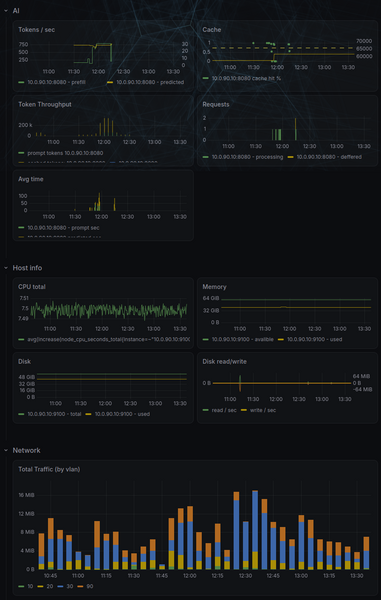
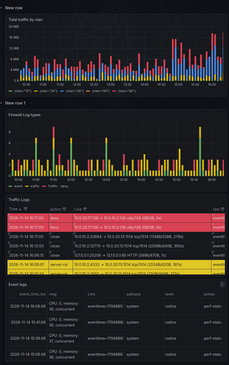
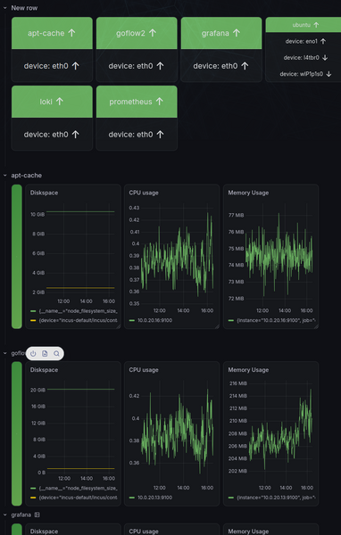

<main>

  

    My home lab setup — where I tinker with servers, networks, and software projects.
  

  <section class="lab-section">
    <h2>Highlights</h2>
    <ul class="lab-list">
      <li><strong>Fully automated setup and configuration</strong> — reproducible infrastructure via <a href="https://github.com/MattyO/self-hosted">Terraform and Ansible</a></li>
      <li><strong>Real-time observability</strong> — Prometheus and Loki with logs from network devices and sFlow traffic analytics</li>
      <li><strong>Segregated hosts via VLANs</strong> — Network isolation across dedicated VLANs for home, work, AI, and server workloads</li>
    </ul>
  </section>

  

    <object id="network-diagram" data="/assets/images/network-overview.drawio.svg" type="image/svg+xml" class="network-svg-object"></object>
    drag to pan &middot; scroll to zoom
  

  <section class="lab-section">
    <h2>Hardware</h2>
    

      

        <h3>Refurbished Dell Blade Server</h3>
        

          server
        

        

          3 TB RAID 5 storage, 125 GB RAM, CPU — enough for now
        

      

      

        <h3>Fortinet F40</h3>
        

          firewall
          fortinet
        

        

          Firewall — network segmentation, firewall policy, dhcp and ipsec tunneling.
        

      

      

        <h3>Cisco C1300</h3>
        

          switch
          cisco
          L2/L3
        

        

          Managed switch — VLAN segmentation and sFlow traffic analytics.
        

      

      

        <h3>FS AP</h3>
        

          wifi
        

        

          Wireless access point — VLAN-aware. provides multiple wans that further segregate connected devices to their correct vlans.
        

      

    

  </section>

  <section class="lab-section">
    <h2>Orchestration, Automation &amp; Containers</h2>
    

      <strong>Ansible</strong> configures all network infrastructure across the FortiGate firewall, Cisco switch, and blade server.
      Containers are run through <strong>Incus</strong>, which pools memory, CPU, and disk space across containers.
      Containers can be deployed into any VLAN available on the network.
      <strong>Terraform</strong> manages container creation, and <strong>Ansible</strong> handles their ongoing configuration and management.
    

  </section>

  <section class="lab-section">
    <h2>Monitoring &amp; Observability</h2>
    

      <strong>Grafana</strong>, <strong>Prometheus</strong>, and <strong>Loki</strong> form the backbone of the lab's observability.
      Logs from hosts, the switch, and firewall are shipped to Loki, while Prometheus collects host and service metrics.
      Grafana provides unified dashboards using data sources from both Loki and Prometheus, offering a single location to monitor system status.
      sFlow network telemetry is collected by a <strong>GoFlow2</strong> collector and forwarded into Loki for long-term log correlation.
    

    

      

        
        
AI Metrics Overview

      

      

        
        
Network Traffic Overview

      

      

        
        
Host Status &amp; Inventory

      

    

  </section>

  

    <a href="/projects.html">← Back to Projects</a>
  

</main>
